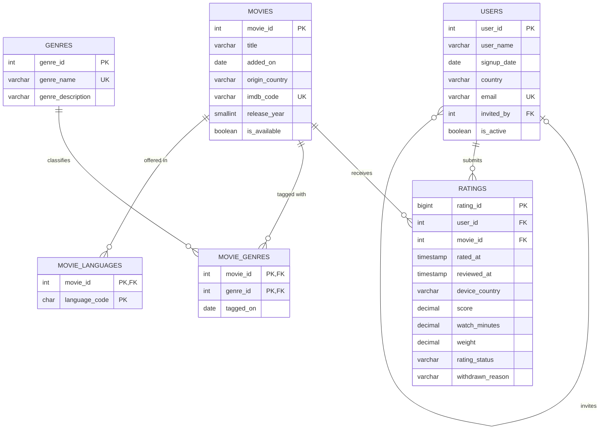

# Movie / TV Ratings Analytics in PostgreSQL

A six-unit SQL audit of a movie ratings platform, from a dashboard number nobody believed to a quarter-by-quarter answer on whether spam is getting better or worse.

**Author:** Nicholas Ku
**Course:** EX 603, Data and Algorithms for Scalable Systems
**Theme:** Movie / TV

## The domain

The platform lets people rate movies. Users are the actors, movies are the producers, and every rating is an event with a timestamp, a score, the country it was submitted from, and a status. A rating is published, flagged for review, or withdrawn, and a withdrawn rating carries a reason such as Spam detected. Movies are classified by genre through a junction table, since one movie can carry several genres.

The project started with a dashboard that showed about half of all ratings being withdrawn as spam, and leadership had frozen a reviewer payout because of it. Each unit took on the next question. Is the dashboard's number right? Which movies does the spam concentrate on? Who is behind those movies, and which movies is every report missing? And finally, is the platform getting better or worse, and what should the team do next quarter?

The questions the platform has to answer are the ones a trust and safety lead and a catalog team would ask. What is the real spam withdrawal rate, and how is it trending? Which movies sit above the typical rate once they have enough ratings to judge? Which movies receive no ratings at all? How many ratings is the platform collecting against its target, and where did it fall behind?

## Database overview

The analysis runs on the course's `ex603_data` reference dataset, which has 30 users, 15 movies, 5 genres and 200 ratings from 2023. The DDL and data come from the course's `movies.sql` file, provided in Unit 3. The diagram below shows that dataset, and its source is in [schema/dataset-erd.mmd](schema/dataset-erd.mmd).



| Table | Rows | How the analysis uses it |
|---|---|---|
| `ratings` | 200 | The event table. `score` is the metric, `rated_at` drives every time series, and a spam withdrawal is a rating whose `withdrawn_reason` is Spam detected. |
| `movies` | 15 | The producers. Reported by `movie_id`. `is_available` comes up when a movie goes quiet. |
| `users` | 30 | The actors. Used to see who submitted spam ratings and whether a join kept every rating. |
| `genres` and `movie_genres` | 5 and 25 | The many-to-many link used to check whether the high-spam movies share a genre. |
| `movie_languages` | | Part of the dataset, not used in the analysis. |

The project also includes my own design from Units 1 and 2, a five-table schema for the same theme with every constraint documented. The design lives in [schema/](schema/) with its own [ERD](schema/erd.png), [DDL](schema/schema.sql), [constraints write-up](schema/constraints.md) and [modelling notes](analysis/unit1.md). The analysis does not depend on it.

## Query catalogue

Every `.sql` file starts with a comment naming the task and the question it answers, and every query carries its own question and the result I got.

### Unit 3: Interrogating the data ([q3_1](queries/unit3/q3_1.sql), [q3_2](queries/unit3/q3_2.sql), [q3_3](queries/unit3/q3_3.sql))

| Query | Business question it answers |
|---|---|
| [3.1](queries/unit3/q3_1.sql) | How many rows does each table hold? |
| [3.1a](queries/unit3/q3_1.sql) | Which movies are still available and were released after 2015? |
| [3.1b](queries/unit3/q3_1.sql) | What statuses can a rating have, how many ratings sit in each, and what reasons do the withdrawn ones carry? |
| [3.1c](queries/unit3/q3_1.sql) | Which ratings scored 4.0 to 5.0, and which are flagged or withdrawn? |
| [3.1d](queries/unit3/q3_1.sql) | Which titles match a pattern, and which ratings have no withdrawal reason? |
| [3.1e](queries/unit3/q3_1.sql) | What does each rating look like with calculated columns in plain language? |
| [3.2A](queries/unit3/q3_2.sql) | Why did the dashboard's spam rate come out near 50 percent, and how many ratings did its filter silently drop? |
| [3.2B](queries/unit3/q3_2.sql) | Why does a query that filters on a SELECT alias fail, and what are two correct rewrites? |
| [3.3a to 3.3d](queries/unit3/q3_3.sql) | Which users wrote a spam withdrawal, answered three ways (IN, CTE, EXISTS) and proven to return the same rows? |
| [3.3e and 3.3f](queries/unit3/q3_3.sql) | Where do the forms stop being equivalent? NOT IN with a NULL in the list returns nothing, and NOT EXISTS returns the real answer. |

### Unit 4: Measuring the platform ([q4_1](queries/unit4/q4_1.sql), [q4_2](queries/unit4/q4_2.sql))

| Query | Business question it answers |
|---|---|
| [4.1a](queries/unit4/q4_1.sql) | Across every rating, what are the count, total, average, minimum, maximum, and number of distinct users and movies? Which ratings sit at the extremes? |
| [4.1b](queries/unit4/q4_1.sql) | How many ratings does each movie have and what is its average score? |
| [4.1c](queries/unit4/q4_1.sql) | Which movies have at least 10 ratings, so that a rate computed for them means something? |
| [4.1d](queries/unit4/q4_1.sql) | For each region and rating status, how many ratings are there and what do their scores look like? |
| [4.2A](queries/unit4/q4_2.sql) | For each movie, how many ratings did it receive and how many were spam withdrawals, in one pass? |
| [4.2B](queries/unit4/q4_2.sql) | What are the ratings and spam withdrawals per region and for the whole platform? |
| [4.2C](queries/unit4/q4_2.sql) | Among movies with at least 10 ratings, what is the baseline spam rate, and which movies sit above it? |

### Unit 5: Joining the data ([q5_1](queries/unit5/q5_1.sql), [q5_2](queries/unit5/q5_2.sql), [q5_3](queries/unit5/q5_3.sql))

| Query | Business question it answers |
|---|---|
| [5.1A](queries/unit5/q5_1.sql) | Which user rated which movie, and when, and did the join keep every rating? |
| [5.1B](queries/unit5/q5_1.sql) | Which movies carry the Comedy tag, and which genres do movies 2 and 3 share? |
| [5.1C](queries/unit5/q5_1.sql) | How do movies released in the same year compare on rating volume and spam rate? |
| [5.2A](queries/unit5/q5_2.sql) | Which producers does an inner join leave out compared with a left join, and how many? |
| [5.2B](queries/unit5/q5_2.sql) | Do a right join and a full outer join agree with the left join, and is any rating missing its movie? |
| [5.2C](queries/unit5/q5_2.sql) | Which producers have never had a rating, found with NOT EXISTS and with EXCEPT? |
| [5.3A](queries/unit5/q5_3.sql) | What does a CROSS JOIN of genres and movies produce, and how many movie and genre pairs are actually tagged? |
| [5.3B](queries/unit5/q5_3.sql) | Which join algorithms does PostgreSQL use for the three-table join, and why? |

### Unit 6: Window functions ([q6_1](queries/unit6/q6_1.sql), [q6_2](queries/unit6/q6_2.sql), [q6_3](queries/unit6/q6_3.sql))

| Query | Business question it answers |
|---|---|
| [6.1A](queries/unit6/q6_1.sql) | Is a rating unusual for its own movie? Every rating beside its movie's average, compared with the GROUP BY version. |
| [6.1B](queries/unit6/q6_1.sql) | Where does each movie land on a leaderboard under ROW_NUMBER, RANK and DENSE_RANK? |
| [6.1C](queries/unit6/q6_1.sql) | Which volume band does each movie fall in with NTILE(4), and are tied movies split across a band boundary? |
| [6.2A](queries/unit6/q6_2.sql) | For movie 2, how does each score compare with the one before and after it, and how many large swings involve a withdrawn rating? |
| [6.2B](queries/unit6/q6_2.sql) | How many ratings has the platform collected against a 240 target, what is the spam rate over the last 30 ratings, and how do ROWS and RANGE differ? |
| [6.2C](queries/unit6/q6_2.sql) | Which movies went unusually long without a rating, and was the rest of the platform still recording ratings at the time? |
| [6.3A](queries/unit6/q6_3.sql) | What are the three best published ratings for each movie, and how are ties at third place handled? |
| [6.3B](queries/unit6/q6_3.sql) | Is the platform getting better or worse month over month and quarter over quarter, with no missing months? |

## Technical highlights

- **NULL-safe filtering (Unit 3).** A filter written as `withdrawn_reason != 'Spam detected'` returned 22 ratings when 188 ratings are not spam. A comparison with NULL is unknown, so the 166 ratings with no withdrawal reason dropped out without any error, and the 12 spam withdrawals ended up measured against a much smaller group. Rewriting the filter with `OR withdrawn_reason IS NULL`, and again with `COALESCE`, brought all 188 back, and the rate fell from about half to the real 6 percent.
- **Conditional aggregation (Unit 4).** `COUNT(*) FILTER` and `CASE` inside an aggregate count all ratings and spam ratings in the same pass, with no WHERE clause. The denominator is always every rating, so the Unit 3 mistake can't happen by construction. `ROLLUP` and `GROUPING()` added regional subtotals and a platform total in one query.
- **Outer joins and anti-joins (Unit 5).** Every earlier report used an inner join and described a catalog of 13 movies. A `LEFT JOIN` returned 15, and `NOT EXISTS` and `EXCEPT` both identified movies 14 and 15, which have never been rated. I now count rows against the source table at each step.
- **Window functions (Unit 6).** `LAG` compares each month with the one before, with `NULLIF` guarding against division by zero and a `generate_series` calendar proving no month is missing. A rolling average over `ROWS BETWEEN 29 PRECEDING AND CURRENT ROW` gives the spam rate over the last 30 ratings, which is far steadier than a monthly rate built on 0 to 2 spam withdrawals.
- **Reading an execution plan (Unit 5).** `EXPLAIN ANALYZE` on the three-table join showed a hash join on `users`, a nested loop with Memoize on `movies` (187 cache hits out of 200), and a row estimate of 100 for a table of 30, which pointed to missing statistics.

## Findings and recommendations

1. **The real spam rate is 6 percent, not 50.** Of 200 ratings, 12 were withdrawn as spam. The dashboard's number came from a filter that silently dropped every rating without a withdrawal reason ([Unit 3 memo](analysis/unit3-finding.md)). The dashboard should count every rating, and the frozen payout can be reviewed against the real figure.
2. **Spam is trending down, but on small numbers.** The quarterly spam rate fell from 7.5 to 6.3, 5.9 and 4.2 percent while volume held at 48 to 53 ratings a quarter. The fourth quarter had only 2 spam withdrawals, so one more would erase most of the improvement. I recommend reporting the quarterly rate with its count, and reviewing a month only when it has at least 3 spam withdrawals or the 30-rating rate passes 10 percent ([Unit 6 memo](analysis/unit6-finding.md)).
3. **The bigger risk is volume and visibility.** The platform finished 2023 40 ratings short of a 240 target, after being 2 ahead in February. A slowdown in March and April, when four movies went about three months without a rating at the same time, lost 18 ratings against the pace, and smaller misses in most of the later months lost another 24. Movies 14 and 15 have never been rated, and every inner-join report left them out ([Unit 5 memo](analysis/unit5-finding.md)). The cheapest next step is to ask the catalog team for the availability history of movies 5, 9, 11 and 12, and whether movies 14 and 15 are visible on the site.

## Limitations and future improvements

The biggest limitation is size. The whole year has 12 spam withdrawals, so every rate in this project rests on a handful of events. I haven't tested the quarterly trend statistically, and with counts this small I wouldn't expect it to hold up as significant. A single spam withdrawal moves a monthly rate by 5 to 9 points and a quarterly rate by about 2. The dataset also stores only current state. `is_available` holds today's value, so I can't tell whether a movie was hidden while it went quiet, and a withdrawn rating keeps a score of 0.5 instead of the score the user gave. More months of ratings would make the trend testable, and a history table for availability changes, plus the original score on withdrawn ratings, would answer the two questions the data can't answer today.

## Video presentation

**[Watch the video presentation](https://drive.google.com/file/d/1Rz-6kF000d1AXMCrDsDE8UNXjviFxyWg/view)**, a short walkthrough of the key queries, the findings, and what I would do next quarter.

## How to run it

You need PostgreSQL 14 or newer and `psql`. Create the database, load the course dataset, then run any query file from the repository root.

```bash
createdb -U postgres ex603_data
psql -U postgres -d ex603_data -f movies.sql
psql -U postgres -d ex603_data -f queries/unit6/q6_3.sql
```

`movies.sql` is the course's reference dataset for the Movie / TV theme, and the file is not stored in this repository. Every query file only reads data, so the files can be run in any order and as many times as needed. `q3_2.sql` contains one query that fails on purpose to show an error, so run that file without `-v ON_ERROR_STOP=1`.

To build my Unit 2 schema instead, run it on a separate empty database. The script drops and rebuilds its own five tables, so it can be run more than once.

```bash
createdb -U postgres movie_design
psql -U postgres -d movie_design -v ON_ERROR_STOP=1 -f schema/schema.sql
```

## Contents

| Path | What it holds |
|---|---|
| [queries/unit3/](queries/unit3/) to [queries/unit6/](queries/unit6/) | One file per task, each starting with the task and the question it answers |
| [analysis/unit3-finding.md](analysis/unit3-finding.md) | Unit 3 memo to the dashboard team |
| [analysis/unit4.md](analysis/unit4.md), [analysis/unit4-finding.md](analysis/unit4-finding.md) | Unit 4 write-ups, reflection, and the breakdown for leadership |
| [analysis/unit5.md](analysis/unit5.md), [analysis/unit5-finding.md](analysis/unit5-finding.md) | Unit 5 write-ups, the execution plan, reflection, and recommendations |
| [analysis/unit6.md](analysis/unit6.md), [analysis/unit6-finding.md](analysis/unit6-finding.md) | Unit 6 write-ups, reflection, and the closing memo |
| [schema/dataset-erd.mmd](schema/dataset-erd.mmd) | Mermaid source for the dataset ERD above |
| [schema/](schema/), [analysis/unit1.md](analysis/unit1.md), [analysis/unit2.md](analysis/unit2.md) | My own Unit 1 and 2 design: ERD, DDL, constraints, and modelling notes |
| [screenshots/](screenshots/) | Each query running with its result, named by query id (for example `Q6 1B.png`) |
