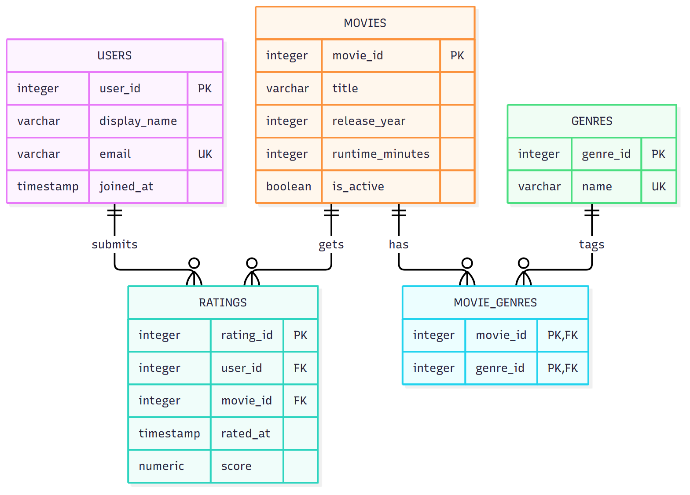

# Movie / TV Ratings Database

A relational design for a platform where users rate movies and movies are classified by genre.

**Author:** Nicholas Ku
**Course:** EX 603, Data and Algorithms for Scalable Systems
**Theme:** Movie / TV

## Domain

This platform lets people rate movies on a half star to five star scale. Users are the actors, movies are the thing being rated, and each rating is recorded as its own event with a timestamp and a score. Movies are classified by genre, and a movie can carry several genres at once, which makes the movie to genre link many to many.

The platform has to answer questions about the movies and about the people rating them. Which movies have the highest average score once a minimum number of ratings is met? Which genres draw the most activity? How many ratings does a movie receive per month? Which users rate the most, and which active movies of a given length are still unrated? Ratings is the high-volume table, so the design aims to keep these questions simple aggregates.

The schema also has to reject invalid state by itself. A score outside the scale, a duplicate rating by the same user on the same movie, a rating for a movie that does not exist, and a movie tagged twice with the same genre should all be impossible to store, whichever application or script does the writing.

## Schema



The editable diagram source is [schema/erd.mmd](schema/erd.mmd), written in Mermaid.

| Role | Relation | Purpose |
|---|---|---|
| actor | `users` | The person who rates movies |
| producer | `movies` | The title being rated |
| event | `ratings` | One rating action, with a timestamp and a score |
| catalog | `genres` | The categories that classify movies |
| junction | `movie_genres` | The many to many link between movies and genres |

### Design decisions to notice

- Every table has a generated INTEGER key. Display names and titles repeat, so none of them can identify a row. Email and genre name are protected by UNIQUE constraints instead.
- A user holds at most one rating per movie. A re-rating updates the existing row, which keeps averages and top-rated lists as plain aggregates.
- `movie_genres` uses the pair of foreign keys as its primary key, so a movie cannot be tagged with the same genre twice.
- A rated movie cannot be deleted. It is retired with `is_active = FALSE`, so rating history is never lost by accident. Deleting a user removes their ratings.
- No derived value is stored. Averages and counts are computed at query time.

## How to run it

Create an empty database, then run the script from the `schema` folder. It drops and rebuilds the five tables, so it can be run repeatedly.

```bash
psql -d your_database -v ON_ERROR_STOP=1 -f schema/schema.sql
```

## Unit 3: Interrogating the Data

Unit 3 uses the course's provided Movie / TV dataset, not the Unit 2 schema above. The scenario is a dashboard that reported about half of all ratings ending as spam withdrawals, which led to a frozen reviewer payout. The queries show that the real rate is 6 percent, and that the dashboard's number came from ratings with a blank withdrawal reason being dropped silently from the total.

To run the queries, create a database named `ex603_data` and load the course's `movies.sql` into it. That file comes from the course and is not stored in this repository. Then run each file from the repository root. `q3_2.sql` contains one query that fails on purpose, so run it without `ON_ERROR_STOP`.

```bash
createdb -U postgres ex603_data
psql -U postgres -d ex603_data -f movies.sql
psql -U postgres -d ex603_data -f queries/unit3/q3_1.sql
psql -U postgres -d ex603_data -f queries/unit3/q3_2.sql
psql -U postgres -d ex603_data -f queries/unit3/q3_3.sql
```

## Unit 4: Measuring the Platform

Unit 4 continues on the same `ex603_data` database. The follow-up question from leadership was what the real failure rate is and which movies contribute most to it. The answer is a 6 percent platform rate (12 spam withdrawals out of 200 ratings), with movies 2 and 3 well above the typical rate for movies with at least 10 ratings. Producers are reported by `movie_id`, not by title. Both files run top to bottom without errors.

```bash
psql -U postgres -d ex603_data -f queries/unit4/q4_1.sql
psql -U postgres -d ex603_data -f queries/unit4/q4_2.sql
```

### Query catalogue

| Query | Business question it answers |
|---|---|
| 4.1a | Across every rating, what are the count, total, average, minimum, maximum, and number of distinct users and movies? |
| 4.1a follow-up | Which ratings sit at the lowest and highest score, and does the average change by status? |
| 4.1b | How many ratings does each movie have and what is its average score, from most rated to least? |
| 4.1c | Which movies have at least 10 ratings, so that a rate computed for them means something? |
| 4.1d | For each region and rating status, how many ratings are there and what do their scores look like? |
| 4.2A | For each movie, how many ratings did it receive and how many were spam withdrawals, in one pass? |
| 4.2B | What are the ratings and spam withdrawals per region, and for the platform as a whole, without detail rows? |
| 4.2C-1 | Among movies with at least 10 ratings, what is the baseline spam rate? |
| 4.2C-2 | Which high-volume movies sit above that baseline, and by how many points? |

## Contents

| Path | What it holds |
|---|---|
| [schema/schema.sql](schema/schema.sql) | The complete DDL script, runnable top to bottom on an empty PostgreSQL 14+ database |
| [schema/schema-definition.md](schema/schema-definition.md) | Relation schemas, attributes, domains, and primary keys |
| [schema/constraints.md](schema/constraints.md) | Integrity constraints and the ON DELETE choice for each foreign key |
| [analysis/unit1.md](analysis/unit1.md) | Unit 1 modelling justification and reflection |
| [analysis/unit2.md](analysis/unit2.md) | Unit 2 constraints table, CHECK narrative, and what changed from Unit 1 |
| [analysis/unit3-finding.md](analysis/unit3-finding.md) | Unit 3 memo to the dashboard team |
| [queries/unit3/q3_1.sql](queries/unit3/q3_1.sql) | Unit 3 exploration queries |
| [queries/unit3/q3_2.sql](queries/unit3/q3_2.sql) | Unit 3 broken queries, the dropped-row count, and the repairs |
| [queries/unit3/q3_3.sql](queries/unit3/q3_3.sql) | Unit 3 three equivalent forms and the proof that they match |
| [analysis/unit4.md](analysis/unit4.md) | Unit 4 write-ups for Tasks 4.1 and 4.2, plus the reflection |
| [analysis/unit4-finding.md](analysis/unit4-finding.md) | Unit 4 breakdown for the leadership team |
| [queries/unit4/q4_1.sql](queries/unit4/q4_1.sql) | Unit 4 baseline, per-movie, HAVING, and two-dimension queries |
| [queries/unit4/q4_2.sql](queries/unit4/q4_2.sql) | Unit 4 conditional aggregation, ROLLUP, and the two-step pipeline |
| [screenshots/](screenshots/) | Execution evidence for Units 2, 3 and 4 |
